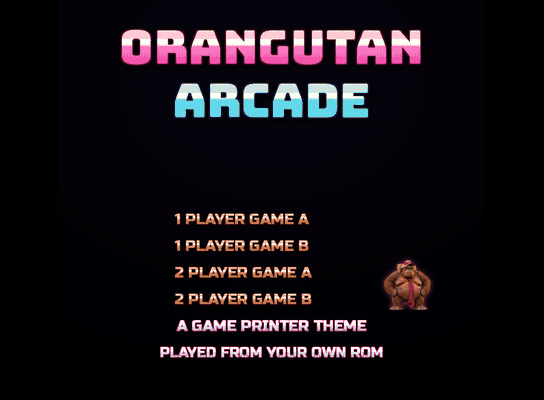

# Orangutan Arcade

A photoreal look and sound for Donkey Kong (NES), played from a ROM you own on a Game Printer page. Pick it under Settings, Theme.

The game is unchanged. Every body keeps its place and hit box; only the pictures change. The big foe is a giant, furious orangutan dusted in cheese-puff powder, wearing a red MG! cap, a cheap blonde toupee and an absurdly long red tie. The one waiting at the top is Señorita, seated on her girder in a black-and-gold sombrero and deeply unimpressed. The hero is a zookeeper in a pith helmet. Barrels are weathered oak, the fires are living flames, the hammer is a sledgehammer, the pies are pans of cheese puffs, and the stages are magenta steel girders and cyan ladders over a near-black backdrop. Points pop up with a cheese puff.

It brings its own music and sound effects too: "Banana Funk" on 25m, a second groove on the other stages (where the game itself plays only a short intro), a fanfare, a stage-clear jingle, hammer and hurry-up loops, and chip-style effects.

## What's here

- `theme/look.txt` names the look and its rules file.
- `theme/art.txt` holds the rules (`gp-art 1`, read by `gp_present::art` in [gameprinter](https://github.com/lex00/gameprinter)): which of the game's pictures each picture replaces and at what size, timed poses (the orangutan's idle, throw and tantrum, Señorita's 8-second idle), the barrel he holds, the fires' facing, the drum and its flames, and how each stage is built from pieces.
- `theme/art/` holds the pictures, at 8 times the game's pixel size.
- `theme/sound/roles/` holds a sound for each of the game's 14 sound roles (16-bit mono WAV, 44.1 kHz), listed in `look.txt`. Giving any role replaces all of the game's own sound.
- `package.toml` names the package, `ddmoney420/orangutan-arcade`.
- `preview.png` is the title screen, for lists of games; `promo.gif` is a short scene made from the theme's own art (no gameplay capture).

## No ROM data

None of these files holds bytes from a Donkey Kong ROM, no picture is traced from the original's art, and no sound or tune comes from the game. The stages aren't pictures: the rules build them in the player's browser, from pieces (a girder, a ladder rung, a cable, a pulley, a rivet), over the level picture read from the player's own ROM. The lettering is drawn from open fonts. `gp template served` checked every file against both ROMs (Donkey Kong: Original Edition and Donkey Kong (JU)) before publishing: it holds no game data.

## How the art was made

The characters, props and stage pieces were generated with Google Gemini image models (`gemini-3-pro-image` and `gemini-nano-banana-2.1`) from our own prompts and references, after an earlier prototype made with ChatGPT's image tool, then cut out, fitted and animated by script. Each picture was redrawn on pure black and on pure white, and the difference between the two gives every pixel's transparency, so there is no green screen and no green fringe. Sizes and offsets were checked in the running game on every stage. The lettering uses Russo One and Bungee (SIL Open Font License 1.1).

The music and sound effects are original: tunes written for this theme and synthesized from scratch in code (numpy; no samples, no recordings), with the code and the tunes written by Claude (Anthropic) at the author's direction.

## License

The pictures, sounds and rules are licensed under [Creative Commons Attribution 4.0 International](https://creativecommons.org/licenses/by/4.0/) (CC BY 4.0); the full text is in `LICENSE`. You may use, change and share them, as long as you credit them:

> Orangutan Arcade art by ddmoney420 (https://github.com/ddmoney420/orangutan-arcade-theme), licensed under CC BY 4.0.

The rules' structure and the stages' colour tests follow Turnips art by lex00 (https://github.com/lex00/turnips), licensed under CC BY 4.0; no Turnips pictures are used. The orangutan is satire. Donkey Kong, its name and its ROM belong to Nintendo and aren't licensed here.
